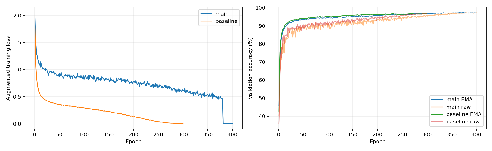

# Results record

Original-run results below come from user-provided checkpoints, logs, and submission files.
The Kaggle score is user-reported; hidden labels were not accessed. The development score
and all 2,000 final submission predictions were independently reproduced on CPU.

| Item | Actual result |
|---|---|
| Final architecture | Pre-activation Wide ResNet, depth 28, widths 56/112/224 |
| Trainable parameters | 4,480,474 |
| Allowed labeled images | 50,000 |
| Development split | 45,000 / 5,000, stratified, split seed 2026 |
| Main best validation accuracy | 97.36% (4,868 / 5,000), epoch 365 |
| Baseline best validation accuracy | 96.98%, from the selection report |
| Selected recipe / raw or EMA / TTA | Main / EMA / horizontal flip |
| Final fit epochs | 400, all 50,000 allowed training images |
| Training GPU and dependency versions | Pending; copy environment and pip freeze files |
| Final checkpoint location and SHA-256 | Private Drive: runs/final/final.pt; 8d463ace4e242a165250cf32871b7c360aa372420c881298ec7594a068bdef92 |
| Submission SHA-256 | e0002d9308d4dbda8c5ba6b6a6b2ed85746bc78a4d32fb5b49f9570fcb5fba8f |
| Kaggle accuracy (user-reported) | 89.7% |
| Code Git commit / repository URL | https://github.com/mj3664-web/cifar-resnet-colab ; record the training commit |

Attach the selected JSON config, selection report, final metadata, environment record,
and checkpoint link. Run `src.predict` with the preserved checkpoint and original archive
to reproduce the submitted predictions. Re-training can have numerical variation across devices.

## Original run artifacts

The supplied configurations and metadata are preserved in [results/original](results/original).
Their JSON contents are unchanged; filenames identify each run. Both supplied recipe
configs exactly match the repository's `configs/main.json` and `configs/baseline.json`.

| Supplied file | Repository artifact | Meaning |
|---|---|---|
| `config (1).json` | [main.config.json](results/original/main.config.json) | Main training configuration |
| `metadata (3).json` | [main.metadata.json](results/original/main.metadata.json) | Main development run: 45,000 training / 5,000 validation |
| `config.json` | [baseline.config.json](results/original/baseline.config.json) | Baseline training configuration |
| `metadata (2).json` | [baseline.metadata.json](results/original/baseline.metadata.json) | Baseline development run: same 45,000 / 5,000 split |
| `selected.json` | [selected.json](results/original/selected.json) | Selected main recipe for the final fit |
| `selected.selection (1).json` | [selected.selection.json](results/original/selected.selection.json) | Main EMA selected: 97.36% versus baseline 96.98% |
| `metadata (1).json` | [final.metadata.json](results/original/final.metadata.json) | Full-data run: 50,000 training / 0 validation |

The selected development checkpoint was from epoch **365**. The final model was trained
from scratch for **400 epochs** using the selected recipe, seed **42**, batch size **128**,
EMA weights, and horizontal-flip inference. The final metadata matches the selected config.
All three metadata files record **4,480,474 parameters**, the same archive hash, and
`deterministic: false`. The `val_fraction: 0.1` field remains in the final config, but
`full_data: true` overrides splitting: its actual validation count is zero.
The selection report retains original Colab paths as provenance; these are not portable
checkpoint download links.

Normalization uses RGB channel statistics from the training portion of each run:

| Run | Mean (R, G, B) | Standard deviation (R, G, B) |
|---|---|---|
| Main and baseline development | 0.49151359, 0.48231471, 0.44681384 | 0.24705093, 0.24347972, 0.26150951 |
| Final full-data fit | 0.49139968, 0.48215841, 0.44653091 | 0.24703223, 0.24348513, 0.26158784 |

Exact precision is preserved in the linked metadata. These files do not record GPU model
or library versions, so the environment record is still needed for full reproducibility.

## Training and validation curves

This is the user-supplied plot of the development runs, not the final full-data run.
The main run lasts 400 epochs; the baseline lasts 300. The main loss drops sharply when
MixUp/CutMix is disabled for the final 20 epochs. Because the recipes use different
augmentation and mixing, their training-loss values are not directly comparable measures
of classification accuracy. The right panel compares raw and EMA validation accuracy;
exact selection results come from the JSON report above, not estimates from the plot.
